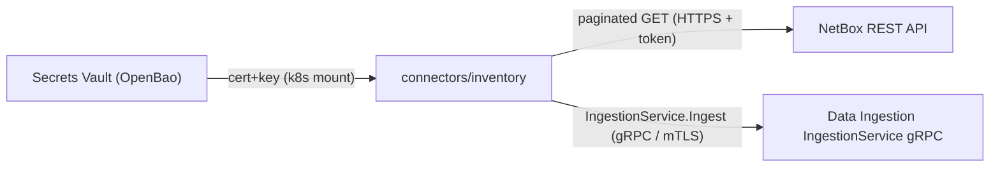
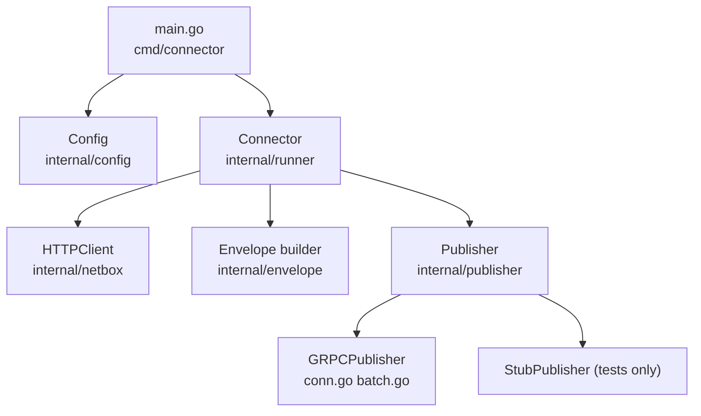
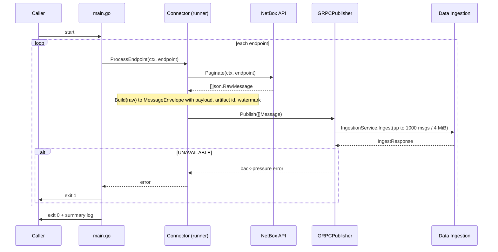

# OCG Inventory Connector — Architecture Diagrams

## System Context

> The connector delivers **raw source records** to Data Ingestion and stops there.
> Everything downstream — schema mapping, IRI construction, entity resolution — is the OCG's concern.

## Internal Components

## Run Sequence

