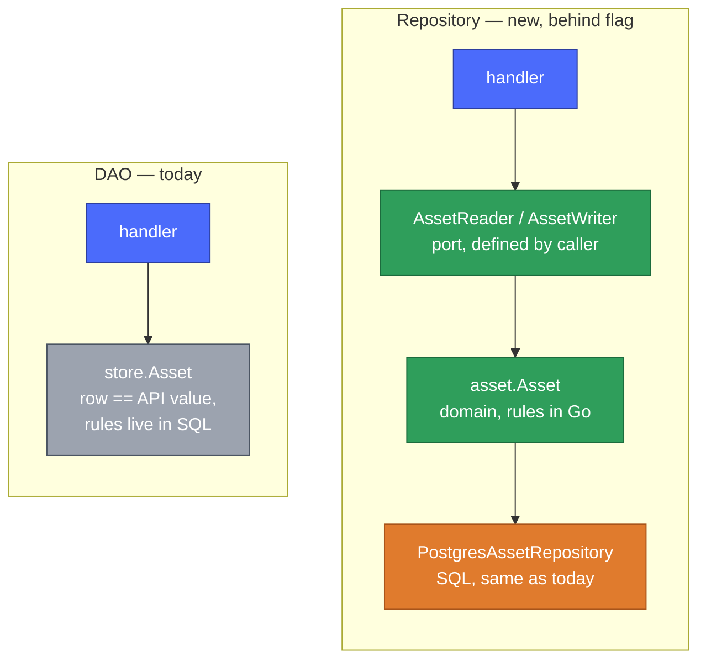

<!--
SPDX-FileCopyrightText: 2026 SAP SE or an SAP affiliate company and Operational Context Graph contributors
SPDX-License-Identifier: Apache-2.0
-->

# DAO vs Repository for the asset store — a before/after

This shows a persistence pattern we applied to the inventory-store asset code, against the current
approach. The repository code is real, ships behind a flag, and is **proven to produce identical
results** to the current code ([Proof](#proof-same-behavior)). Judge the scenarios for yourself.

## The pattern in one minute

Two well-known, boring ideas — not invented here:

- **Domain Model** — a plain in-memory type holding a valid *thing* and its rules, with no knowledge
  of SQL. ([Fowler, PoEAA](https://martinfowler.com/eaaCatalog/domainModel.html);
  [Evans, DDD](https://martinfowler.com/bliki/DomainDrivenDesign.html).)
- **Repository** — a small interface that hands you domain objects and takes them back, hiding how
  they are stored ([Fowler, PoEAA](https://martinfowler.com/eaaCatalog/repository.html)). The
  interface is defined by the code that *uses* it — the Go proverb
  ["accept interfaces, return structs"](https://go.dev/wiki/CodeReviewComments#interfaces).

Today we use a **DAO** (Data Access Object): one struct is both the database row and the value callers
use, and the rules live in SQL. Also legitimate. The question is only which costs less *for this code*.



Blue = HTTP edge, green = domain, orange = SQL adapter (same colors across these docs). The grey node
is the DAO's single `store.Asset` doing three jobs at once — row, API value, home of the rules.

### Why separate the domain? (the part that bites later)

When the model and the database row are one type, every rule you want to express has to be phrased as
SQL, and every component that touches an asset drags the database in with it. It feels fine at three
callers. At thirty, a new field or a changed rule means editing scan lists, column orders, and every
consumer — and the only way to test any of it is to boot Postgres. The cost is invisible on day one
and compounding by month six. Separating the domain draws one line: **the database stays behind a
port, and everything above it is plain Go.** Concretely, in the repo stack `pgxpool` is imported by
*exactly two files* — the adapter. The domain package and the HTTP handlers import neither `pgx` nor
`store`:

```go
// internal/inventory/asset/adapters/asset_postgres_repository.go — the ONLY place SQL lives
var _ asset.AssetRepository = (*PostgresAssetRepository)(nil) // compile-time: adapter fits the port
```

Move the database and you touch one package; everything above the port is unaware.

## Scenario 1 — add a nullable field (`owner`)

**Before (DAO).** `store.Asset` is the row *and* the value every caller holds. Adding `owner` means
editing the struct, the SELECT/INSERT column lists, and the scan targets — and because that struct is
also the API value, the change recompiles every consumer that reads an asset. No compiler-enforced line
tells you where "row" ends and "domain" begins; they are the same type.

**After (Repository).** The row DTO (`postgresAsset`) and the domain type (`asset.Asset`) are
separate. You add the column to the DTO and the mapping, and an accessor to the domain type. A consumer
that does not care about `owner` is untouched. The boundary is a type, so the compiler shows exactly
what the change reaches.

> Net: the DAO change is smaller to type but wider in blast radius; the repository change is one more
> file but contained.

## Scenario 2 — a re-delivery arrives (dedup decision)

A source re-sends an asset with an unchanged `last_updated_at_source`; we must **not** write a new
version. In the DAO that decision is three lines wedged inside the `UpsertAsset` SQL transaction —
reachable only through Postgres, testable only with a running database. In the repository it is a pure
function (`asset.Update.IsRedeliveryOf`) the adapter calls, unit-tested with no database. Same
rule; see [Spot 2](#spot-2--the-dedup-rule-only-exists-inside-a-transaction) for both snippets.

> Net: same rule. In the DAO it is reachable only through Postgres; in the repository it is a plain
> function you can test and read on its own.

## Scenario 3 — a new consumer needs assets (a cache, an ingest worker)

**Before (DAO).** The new code depends on `*store.Store` and speaks in `store.Asset`, `store.Cursor`,
`store.BatchResult`. Persistence vocabulary leaks into a component that has nothing to do with SQL, and
testing it needs a real store or a hand-rolled fake of the whole concrete type.

**After (Repository).** The new code declares the *narrow* port it needs:

```go
type assetReader interface {
    GetAsset(ctx context.Context, id uuid.UUID) (*asset.Asset, error)
    ListAssets(ctx context.Context, artifactType, sourceSystem, sourceID string, limit int, after *asset.Cursor) ([]*asset.Asset, *asset.Cursor, error)
}
```

It depends on an interface, not a database. Tests pass a tiny fake (we do exactly this in
`internal/httpapi/assets_repo_test.go`), so the consumer is testable with zero Postgres and no
knowledge of the store package.

> Net: the DAO couples new code to the database; the repository lets new code depend on a one- or
> two-method interface it defines itself.

## Three concrete spots

Not hand-picked worst cases — these are the asset write path, read as it stands today.

### Spot 1 — the same expire/dedup/insert body, written twice

`UpsertAsset` (`internal/store/assets.go:24`) and `UpsertAssetBatch` (`:196`) carry the *same* temporal
logic — the dedup check, the `valid_from` computation, the `expire` exec, the
`created := tag.RowsAffected() == 0` heuristic — copy-pasted:

```go
// assets.go — appears verbatim in BOTH UpsertAsset and the UpsertAssetBatch loop
if rowExists && in.LastUpdatedAtSource != nil && cur.LastUpdatedAtSource != nil {
    if cur.LastUpdatedAtSource.Equal(*in.LastUpdatedAtSource) { /* re-delivery */ }
}
tag, err := tx.Exec(ctx, expire, in.SourceSystem, in.SourceID, validFrom)
created := tag.RowsAffected() == 0
```

Any fix to the temporal contract must be made in two places and kept in sync. **Better, in our repo:**
the write path has one `upsertTx` and the decision is one function (`asset.Update.IsRedeliveryOf`),
called from both the single and batch paths — the batch is a loop over the same primitive, not a second
copy of it.

### Spot 2 — the dedup rule only exists inside a transaction

The "is this a re-delivery?" decision is three lines wedged between a `SELECT ... FOR UPDATE` and an
`UPDATE`, reachable only through Postgres (`assets.go:54`). To read it you read SQL; to test it you
boot a database. **Better, in our repo** (`internal/inventory/asset/update.go:29`):

```go
func (u Update) IsRedeliveryOf(current *Asset) bool {
    if current == nil || u.LastUpdatedAtSource == nil || current.lastUpdatedAtSource == nil {
        return false
    }
    return current.lastUpdatedAtSource.Equal(*u.LastUpdatedAtSource)
}
```

Same rule, now a pure function: it reads in one place and is unit-tested with no database
(`update_test.go`, `TestUpdate_IsRedeliveryOf`, five cases).

### Spot 3 — the outcome is a bare string (and the comment already lies)

`internal/store/model.go:45`:

```go
type BatchResult struct {
    ID      uuid.UUID `json:"id"`
    Outcome string    `json:"outcome"` // "created" or "updated"
}
```

The comment names two values; the code emits three — it also returns `Outcome: "unchanged"`
(`assets.go:235`), a real outcome the comment omits. The set of valid outcomes lives only in scattered
string literals, so the type permits any string and a typo like `"creatd"` still compiles. **Better, in
our repo** (`internal/inventory/asset/update.go:48`):

```go
type UpsertResult struct {
    Asset      *Asset
    Created    bool // brand-new asset
    Redelivery bool // nothing written — unchanged re-delivery
}
```

The outcome is typed state. The string encoding exists in exactly one place, a `batchOutcome` function
at the HTTP edge (`assets_repo.go:171`), where the three cases are a single `switch` the compiler sees.

## Complexity: isolated, not removed

Cyclomatic complexity per function (`gocyclo`). The point is not "lower numbers" — it is *where* the
complexity sits.

| Concern | Legacy `store` | Repo stack |
| --- | --- | --- |
| Upsert, business path | `UpsertAsset` **13** (SQL + dedup + mapping in one) | `handleUpsertAssetRepo` **6** + `IsRedeliveryOf` **4** |
| Batch | `UpsertAssetBatch` **14** | `handleUpsertAssetBatchRepo` **8** |
| SQL paging | `ListAssets` **12** | adapter `ListAssets` **13** |

The repo stack does **not** make everything simpler — the adapter's `ListAssets` is a **13**, because
keyset pagination over SQL is genuinely that complex, and that is fine: it is the one place SQL is
supposed to live. What changed is that the *decision* logic left the big functions. In the legacy path
the dedup rule is tangled inside a complexity-13 database function; in the repo path it is a
complexity-4 pure function you can read and test on its own. Complexity was moved to where it belongs,
not conjured away.

> Regenerate: `go run github.com/fzipp/gocyclo/cmd/gocyclo@latest -top 15 ./internal/...`

## Proof: same behavior

None of this is a rewrite risk. The two asset stacks run side by side behind `OCG_IS_READ_PATH`
(`dao` default | `repo`) and share no code — only the `api/v1` JSON contract. Eight equivalence tests
in `internal/equivtest` apply identical input to both and assert identical stored rows and identical
reads: first delivery, exact re-delivery, advancing timestamp, nil timestamp, mixed batch, plus
get / list+cursor / not-found. They pass. Same input, same rows.

```
go test -tags integration ./internal/equivtest/   # 8/8 pass against a throwaway database
```

## What this is not

Not a proposal to rip out `internal/store`. The repository is additive and off by default; if it does
not earn its keep, deleting `internal/inventory*` and the one repo handler file restores the status
quo with the legacy path untouched.
