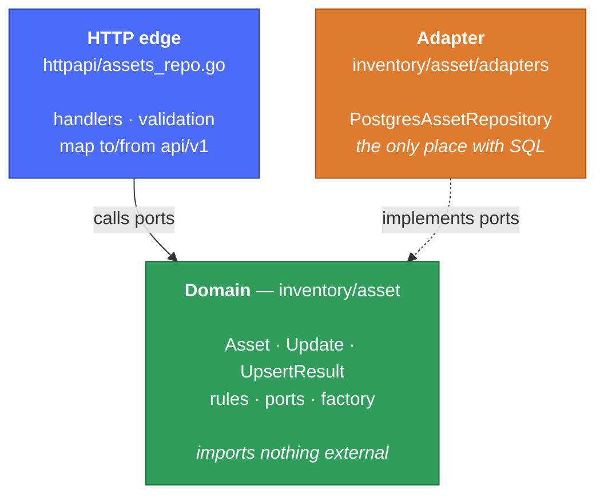
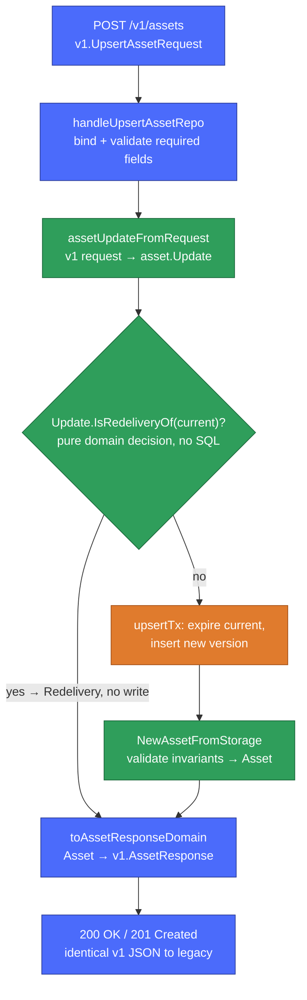

<!--
SPDX-FileCopyrightText: 2026 SAP SE or an SAP affiliate company and Operational Context Graph contributors
SPDX-License-Identifier: Apache-2.0
-->

# Inventory-store asset repository stack — how it works

This describes the repository-backed asset stack: the one selected when `OCG_IS_READ_PATH=repo`. It
runs beside the legacy DAO path and shares only the `api/v1` JSON contract. If you are weighing the
pattern itself, read [dao-vs-repository.md](dao-vs-repository.md) first; this doc is the reference for
how the code is laid out.

## Layers and dependency direction

Three layers. Every arrow points **inward**, toward the domain. The domain (`inventory/asset`)
imports nothing external; the HTTP edge and the SQL adapter both depend on it. The adapter is plugged
in from outside, so the domain never imports a database driver and the handlers never import `store`.



Read it as one sentence: **the edge and the adapter both depend on the domain; the domain depends on
neither.** That inward-only rule is the whole point — swap the adapter, the domain and handlers do not
move.

The arrow from the adapter is enforced at compile time
(`internal/inventory/asset/adapters/asset_postgres_repository.go:34`):

```go
var _ asset.AssetRepository = (*PostgresAssetRepository)(nil)
```

If the adapter ever drifts from the port, the build fails — not a runtime surprise.

## The three types that carry state

Three small types do all the work. Here they are in full:

```go
// inventory/asset/update.go — "what the caller wants changed"
type Update struct {
    Key                 NaturalKey
    IRI, Name           *string
    ArtifactType        string
    Extensions          []byte
    IngestedAt          *time.Time
    CreatedAtSource     *time.Time
    LastUpdatedAtSource *time.Time
}

// inventory/asset/update.go — the structured outcome of a write (no magic strings)
type UpsertResult struct {
    Asset      *Asset
    Created    bool // brand-new asset
    Redelivery bool // nothing written — unchanged re-delivery
}
```

```go
// inventory/asset/asset.go — "a valid stored thing": all fields private, read via accessors
type Asset struct {
    id       uuid.UUID
    key      NaturalKey
    // …
    validity Validity
}

func (a Asset) ID() uuid.UUID      { return a.id }
func (a Asset) Key() NaturalKey    { return a.key }
func (a Asset) Validity() Validity { return a.validity }
```

`Update` and `Asset` are deliberately different types — one is the incoming command, the other is a
valid stored aggregate. Because `Asset`'s fields are private, the factory is the **only** way to build
one, so every `Asset` in memory has passed its invariants. The DAO path instead collapses both roles
into a single `store.Asset`.

## The port, and a fake that needs no database

Handlers depend on a narrow interface they define themselves, not on a concrete store
(`httpapi/assets_repo.go:24`):

```go
type assetReader interface {
    GetAsset(ctx context.Context, id uuid.UUID) (*asset.Asset, error)
    ListAssets(ctx context.Context, artifactType, sourceSystem, sourceID string,
        limit int, after *asset.Cursor) ([]*asset.Asset, *asset.Cursor, error)
}
```

So a test drives the full HTTP path against an in-memory fake — zero Postgres
(`httpapi/assets_repo_test.go`):

```go
b := &fakeAssetBackend{
    get: func(_ context.Context, _ uuid.UUID) (*asset.Asset, error) {
        return nil, store.ErrAssetNotFound // force the 404 path
    },
}
rr := test.GetRequest(t, repoServer(b).Handler, httpapi.PathAssets+"/"+uuid.New().String())
// asserts 404 — no database involved
```

A different backend (a cache, a second database) is just a new type that satisfies the same port;
nothing above the adapter changes.

### Why three ports (reader / writer / repository)?

The domain (`inventory/asset/ports.go`) declares the asset port in three pieces:

```go
type AssetReader interface { GetAsset(...); ListAssets(...) }      // read only
type AssetWriter interface { Upsert(...); UpsertBatch(...) }       // write only
type AssetRepository interface { AssetReader; AssetWriter }        // both
```

This is [interface segregation](https://go.dev/wiki/CodeReviewComments#interfaces): a consumer depends
only on the half it uses. The Postgres adapter satisfies the full `AssetRepository`; a future
read-only consumer (a cache, a projection) can depend on just `AssetReader` and need no write methods.

One honest note for maintainers: **today no consumer uses the halves separately** — the HTTP stack
already defines its own even-narrower ports locally (`httpapi/assets_repo.go`), and `main.go` passes
the whole repository. So the reader/writer split is a deliberate roadmap signal for the read-only
consumer we expect, not dead code and not load-bearing yet. If that consumer never arrives, the split
can collapse to a single `AssetRepository` with no caller change.

## Walkthrough: one upsert request

Each step is colored by the layer it runs in — blue = HTTP edge, green = domain, orange = adapter/SQL
— so you can see the request cross boundaries and come back.



The decision that was embedded in SQL in the DAO path (`IsRedeliveryOf`) is a plain function here; the
adapter calls it, and the SQL does persistence only.

## Where each responsibility lives

- **Wire contract** (`api/v1`): request/response JSON. Shared by both stacks, owned by neither.
- **HTTP edge** (`httpapi/assets_repo.go`): binding, validation, mapping to/from `v1`, status codes.
  Imports `inventory/asset` and `api/v1` — **never** `store`. Declares its own narrow `assetReader` /
  `assetWriter` ports (accept interfaces).
- **Domain** (`inventory/asset`): the `Asset` aggregate, the `Update` command, the business rules
  (`IsRedeliveryOf`, `ValidityBoundary`), the `Cursor`, and the port interfaces. No SQL, no HTTP, no
  external imports.
- **Adapter** (`inventory/asset/adapters`): the only place that speaks Postgres. Maps rows to domain assets
  via the factory, implements the ports.

## How to swap or fake the backend

Shown above: handlers depend on the `assetReader` / `assetWriter` ports, so a test drives the full
HTTP path against an in-memory fake with no database. A real alternative backend — a cache, a second
database — is the same move: a new type that satisfies the ports. Nothing above the adapter changes.

## Flag and mounting

`cmd/inventory-store/main.go` reads `OCG_IS_READ_PATH` and hands `NewServer` a
`PostgresAssetRepository`. `server.go` mounts the repo asset routes when the flag is `repo`, otherwise
the legacy routes. Relationships and health always use the legacy store. Exactly one asset stack is
live per process.
